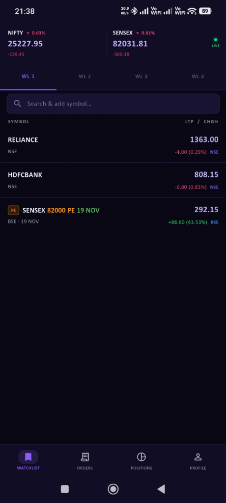
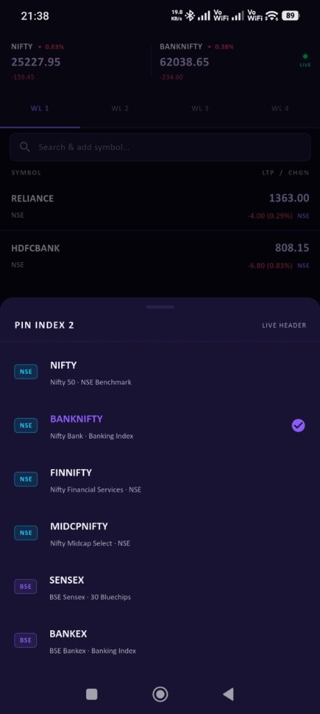
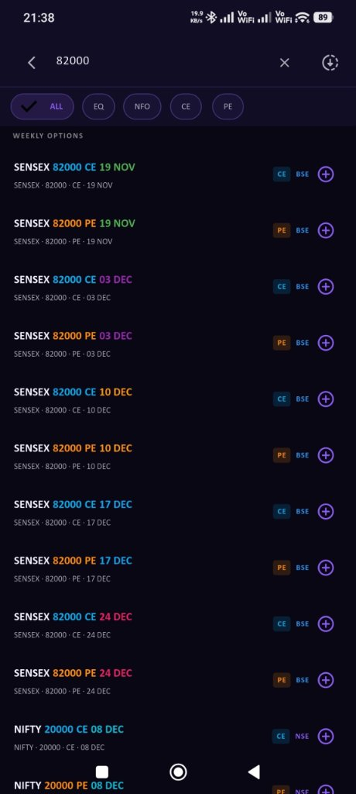
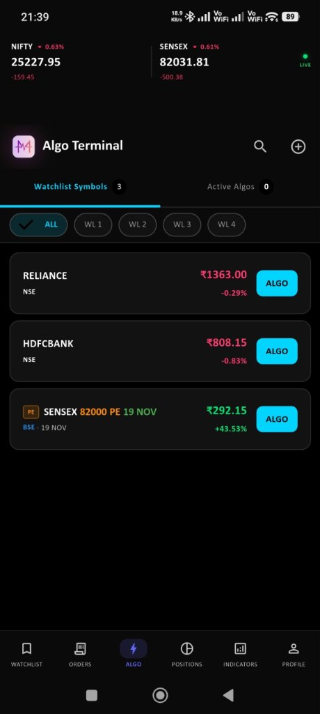
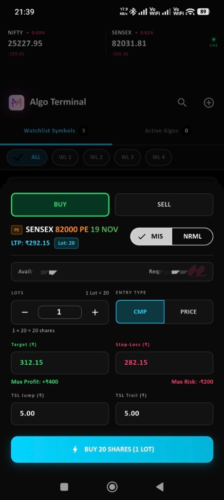
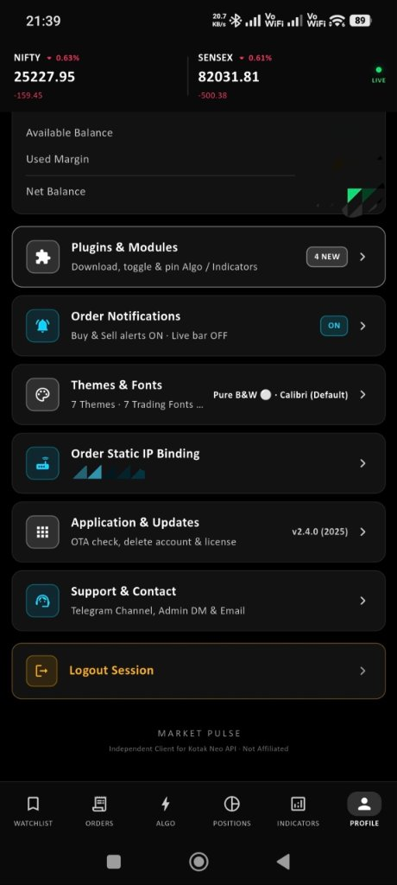
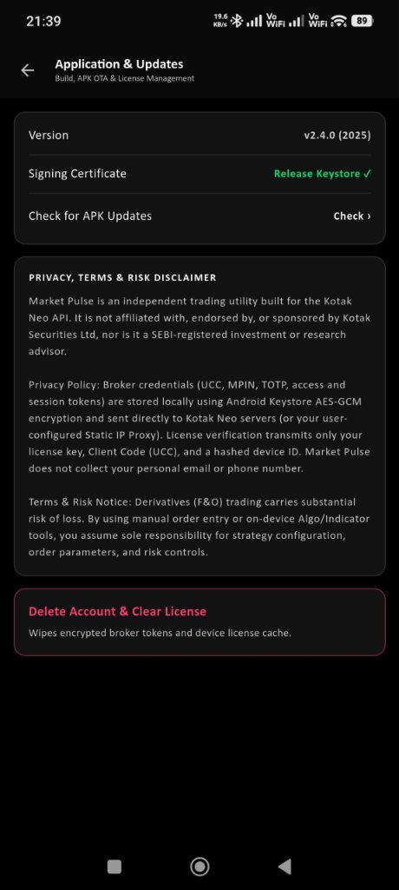

  

<h1 align="center">Market Pulse Trading Terminal</h1>

  <strong>Fast, Minimalist Android Trading Terminal &amp; On-Device Algo Engine for Kotak Neo API</strong>

  
  
  
  

  

  Recommended for 99% of Android phones (64-bit ARM). Using an older 32-bit phone? <a href="https://github.com/anivimorthala/Market_Pulse/raw/main/releases/MarketPulse-v2.4.5-arm32.apk">Download ARM32 APK (20.3 MB)</a>

---

## 🎯 Problems Market Pulse Solves

Intraday F&O traders using Kotak Neo hit the same daily roadblocks:
1. **No native Trailing Stoploss (TSL) or automated Target + SL management on mobile** → Market Pulse runs an **On-Device Algo Engine** that tracks live ticks, trails your SL automatically, and lets you live-edit Target/SL/TSL mid-trade.
2. **SEBI's Static IP rule feels complicated** → Market Pulse bundles a **5-minute AWS Free Tier guide + 1-click Nginx setup + built-in Static IP Binding & Ping Test**.
3. **Heavy, cluttered broker UIs slow down fast executions** → Market Pulse delivers a **minimalist 1-tap Watchlist & Order Pad**, live **Order Book Imbalance (OBI)**, and instant fill notifications.

- **Start in under 60 seconds** with an instant **7-Day Free Trial** — just enter your Kotak Client Code.
- **100% On-Device Execution & Privacy** — your broker credentials never touch any third-party trade server.

---

## 📱 App Preview (`v2.4.0`)

  <table>
    <tr>
      <td align="center">
         
        <b>Watchlist &amp; Live Header</b>
      </td>
      <td align="center">
         
        <b>Pin Any 2 Live Indices</b>
      </td>
      <td align="center">
         
        <b>F&amp;O Strike Search</b>
      </td>
      <td align="center">
         
        <b>Algo Terminal (AMOLED)</b>
      </td>
    </tr>
  </table>

  <table>
    <tr>
      <td align="center">
         
        <b>Target, SL &amp; Trailing SL (TSL) Sheet</b>
      </td>
      <td align="center">
         
        <b>Plugins, 7 Themes, Alerts &amp; Static IP</b>
      </td>
      <td align="center">
         
        <b>OTA Updates &amp; On-Device Privacy</b>
      </td>
    </tr>
  </table>

---

## ✨ Key Highlights

| Feature | What It Does |
| :--- | :--- |
| **⚡ Ultra-Fast Watchlist & 1-Tap Order Pad** | Live ticks for **NIFTY, BANKNIFTY, FINNIFTY, MIDCPNIFTY, SENSEX, BANKEX** options & equities with instant Buy/Sell sheets, customizable pinned index headers, and live Positions / Orders / Funds sync. |
| **🤖 On-Device Algo Terminal** | Set **Entry, Target, Stoploss, and Trailing Stoploss (TSL)** directly on your device. **Live-edit Target/SL/TSL** mid-trade with 1-tap `SL → Cost` and `Lock 50%` profit chips. |
| **🛡️ Active Algo Background Guard** | Automatically protects live Algo Target/SL/TSL monitoring even when you minimize the app or lock your screen — and auto-dismisses the moment your last Algo closes. |
| **📊 Modular Indicators & Order Book Imbalance** | Enable/disable built-in analytical plugins cleanly from **Settings → Plugins & Modules**, including real-time **Order Book Imbalance (OBI)** across your watchlisted strikes. |
| **🌐 SEBI-Compliant AWS Static IP Support** | Built-in **Static Order IP Binding** with 1-tap live ping test, persistent dual-storage memory, and a bundled 2-page AWS Free Tier setup guide. |
| **🔐 Bank-Grade Local Privacy** | Broker tokens (UCC, MPIN, Access Token, Session Token) are stored inside **Android Hardware Keystore (AES-GCM)**. Market Pulse **does not collect** your personal email or phone number. |
| **🎨 7 Custom Themes & 7 Trading Fonts** | Switch between **Pure B&W (AMOLED), Signature Dark, Obsidian, Glass, Light** and more with crisp monospace price alignment. |

---

## 🚀 Quick Start (4 Steps)

1. **Download & Install** — Tap the green **Download APK (`v2.4.5`)** button above and allow installation from your browser/Files app.
2. **Activate 7-Day Free Trial** — Enter your Kotak Neo **Client Code (UCC)** and tap **`START 7-DAY FREE TRIAL`**.
3. **Connect Kotak Neo API** — Enter your Kotak Neo Trade API **Access Token**, registered mobile, MPIN, and 6-digit TOTP.
4. **Bind Static IP (for API Orders)** — Follow our 5-minute **AWS Free Tier Static IP Guide** so Kotak Neo accepts API orders seamlessly.

👉 **Full walkthrough:** [Setup & Onboarding Guide](docs/SETUP_GUIDE.md)

---

## 📚 Documentation Hub

| Guide | Description |
| :--- | :--- |
| 📖 **[Setup & Onboarding Guide](docs/SETUP_GUIDE.md)** | Step-by-step installation, 7-Day Free Trial activation, Kotak Neo API Token & TOTP registration. |
| 🧠 **[How Market Pulse Works](docs/HOW_IT_WORKS.md)** | Deep-dive into Watchlists, On-Device Algo (Target/SL/TSL & Live Edit), Indicators (OBI), Notifications & OTA Updates. |
| ☁️ **[AWS Static IP Setup Guide (Web)](docs/AWS_STATIC_IP_SETUP.md)** | Mobile-friendly step-by-step guide to spin up a free AWS EC2 Elastic IP + 1-click Nginx proxy in 5 minutes. |
| 📄 **[AWS Static IP Setup Guide (PDF)](docs/AWS_Kotak_Static_IP_Setup_Guide.pdf)** | Clean 2-page printable/offline PDF guide (also bundled inside the app). |
| 🛡️ **[Privacy Policy & Risk Disclaimer](docs/PRIVACY_AND_DISCLAIMER.md)** | How your data is encrypted, what is transmitted, and regulatory disclosures. |
| 🆕 **[Release Notes (Changelog)](CHANGELOG.md)** | What's new in `v2.4.5`. |

---

## 📦 Download & Verification (`v2.4.5`)

| Build | Architecture | Size | SHA-256 Checksum |
| :--- | :--- | :---: | :--- |
| **[MarketPulse-v2.4.5-arm64.apk](https://github.com/anivimorthala/Market_Pulse/raw/main/releases/MarketPulse-v2.4.5-arm64.apk)** *(Recommended)* | 64-bit ARM (`arm64-v8a`) | 22.68 MB | `190C695CE69DC04169C8ADC80A53421B1C15EFF1EBA90DDE8A81C64401666865` |
| **[MarketPulse-v2.4.5-arm32.apk](https://github.com/anivimorthala/Market_Pulse/raw/main/releases/MarketPulse-v2.4.5-arm32.apk)** *(Legacy devices)* | 32-bit ARM (`armeabi-v7a`) | 20.31 MB | `4723C5B69E5B8E39491A19C937F8EB9468C8B5147F6967A2C7CE433C83271E94` |

> **Future Updates:** Once installed, Market Pulse checks for new versions automatically inside **Profile → App Updates** (with a live badge on your bottom bar when an update is ready).

---

## 💬 Support

- **7-Day Free Trial:** Instant activation right inside the app with your Kotak Client Code.
- **Need Support?** If any support is needed regarding the app, setup, or access:
  - **Telegram:** [@ANIVIREDDY](https://t.me/ANIVIREDDY)
  - **Email:** [anivimorthala@gmail.com](mailto:anivimorthala@gmail.com)

---

## ⚠️ Regulatory & Risk Disclaimer

> **Market Pulse** is an independent trading utility built for the Kotak Neo Trade API. It is **not affiliated with, endorsed by, or sponsored by Kotak Securities Ltd**, nor is it a **SEBI-registered investment or research advisor**.
>
> Derivatives (F&O) trading carries substantial risk of capital loss. All orders, Algo parameters, and risk controls are configured and executed solely at the user's discretion and responsibility. Please review the full [Privacy Policy & Risk Disclaimer](docs/PRIVACY_AND_DISCLAIMER.md) before trading.
